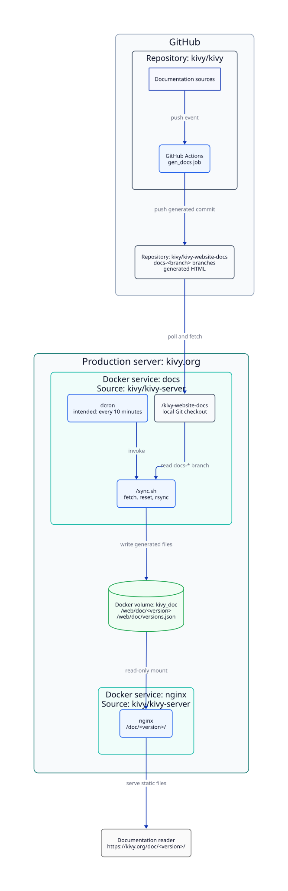

# Documentation deployment flow

Kivy documentation is built from the source repository, published to the
generated-documentation repository, and then synchronized to the production
server by the services defined in this repository.



The repositories and server components have separate responsibilities:

1. The [`kivy/kivy`](https://github.com/kivy/kivy) repository owns the source
   documentation and the GitHub Actions job that builds the Sphinx HTML.
2. The build pushes generated HTML to the matching `docs-<branch>` branch in
   [`kivy/kivy-website-docs`](https://github.com/kivy/kivy-website-docs). For
   example, Kivy's `master` branch maps to `docs-master`.
3. On the `kivy.org` production server, the `docs` container periodically
   fetches those branches and runs [`sync.sh`](sync.sh). The script maps each
   `docs-<version>` branch to `/web/doc/<version>/` and writes
   `/web/doc/versions.json`.
4. The `docs` and `nginx` containers share the `kivy_doc` Docker volume. The
   `docs` container writes it, while `nginx` mounts it read-only and serves it
   at `https://kivy.org/doc/<version>/`.

The editable diagram source is [`deployment-flow.d2`](deployment-flow.d2).

Regenerate the SVG with D2 0.7.1 or later:

```shell
d2 --layout=elk --theme=0 docs/deployment-flow.d2 docs/deployment-flow.svg
```
